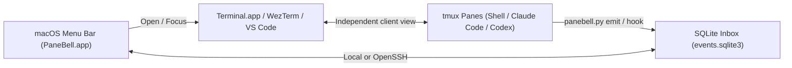

# PaneBell

[](https://github.com/llm4omics/panebell/actions/workflows/ci.yml)
[](LICENSE)
[](#requirements)

**[English](README.md) · [简体中文](README.zh-CN.md) · [Interactive Web Demo](https://llm4omics.github.io/panebell/)**

**PaneBell** puts your local or remote `tmux` projects—and their requests for your attention—in the macOS menu bar. Click a project to jump straight back to its terminal pane. When a batch run or AI coding session finishes while your Mac is asleep or offline, its completion receipt is still waiting when you reconnect.

```text
  Menu Bar:  [ PaneBell · 2 ]
               ├── Waiting for you (1)
               │     └── Paper Planes          ──▶ Opens exact tmux pane to review & approve
               ├── Unread completions (1)
               │     └── Lantern Atlas         ──▶ Durable summary; stays until marked as read
               ├── Pinned
               │     └── Paper Planes · sketchbook
               │           ├── ~/Sandbox/paper-planes
               │           ├── Open window
               │           ├── Open side by side
               │           ├── Unpin
               │           ├── Open in VS Code
               │           └── Copy project path
               ├── Recently opened
               ├── Projects
               ├── Live windows (3)
               ├── ─────────────────────────
               ├── Refresh
               ├── Open settings…
               └── Quit
```

## Why PaneBell?

- **Return to the right pane in one click** — Reuses an existing terminal window for the project or opens a shell in its configured directory. **Open side by side** attaches an independent `tmux` view (`pb-view-…`) so two windows can inspect different panes of the same session without switching each other.
- **Durable, offline-safe receipts** — Desktop notifications disappear; PaneBell's SQLite inbox on the project host keeps explicit `complete` summaries until you mark them as read, and syncs offline acknowledgements automatically on reconnect.
- **Honest states, never guessed** — Closing a waiting pane hides its stale prompt without manufacturing a fake completion. Repeated delivery of the same run ID is deduplicated safely.
- **Observe-only AI agent integrations** — Includes ready-to-use adapters for **Claude Code** (`PermissionRequest` reminders that jump to the exact pane without auto-granting permissions or storing tool arguments) and **Codex CLI** (`agent-turn-complete` receipts), plus a 1-line `emit` CLI for any script or runner.
- **Zero daemon, zero cloud, zero LLM polling** — Runs natively on macOS (`AppKit`) and talks to your project host over plain `tmux` and your existing OpenSSH config (`ControlMaster`). No background server process, no open ports, no external account, and no model API calls.

## How it works



## Try the 30-second demo (no setup required)

On a Mac with Xcode Command Line Tools, run the built-in memory-only demo from this directory:

```sh
./demo.sh
```

1. Click **PaneBell Demo · 1 → Waiting for you → Paper Planes** in the macOS menu bar.
2. A small demo window asks permission to check three fictional colours (`teal`, `amber`, `teal`). Click **Allow check**, then close the window.
3. Open **Unread completions** in the menu bar—the result remains unread until you explicitly click **Mark as read**.

The demo runs entirely in memory and touches no server, `tmux` session, model account, or SSH key.

## Requirements

| Machine | Requirements |
|---|---|
| **Mac (menu bar client)** | macOS 13+, Xcode Command Line Tools (`swiftc`), Python 3.9+. Optional: WezTerm, Visual Studio Code |
| **Project host (local Mac or SSH host)** | `tmux`, Python 3.9+, standard OpenSSH key authentication (when remote) |

## 30-second install & automated setup (recommended)

### Option A: Paste into your AI coding agent (Claude Code, Codex CLI, etc.)

Copy and send this prompt to an agent running on your Mac:

> Install and configure PaneBell from `https://github.com/llm4omics/panebell.git` (clone into `~/Applications/panebell-src` if not already in a checkout). Read `README.md` and `docs/setup.md`: if I run `tmux` on a remote SSH host from `~/.ssh/config`, ask me which host alias to use and run `./install.sh --setup --ssh-host <alias>`; otherwise run `./install.sh --setup` for local `tmux`. This builds and self-tests `PaneBell.app`, installs `~/.local/lib/panebell/panebell.py`, scans active `tmux` panes into `~/.config/panebell/config.json` without overwriting existing entries, and losslessly merges Claude Code's observe-only `PermissionRequest` hooks (`~/.claude/settings.json`) and Codex CLI's `notify` callback (`~/.codex/config.toml`, chaining any existing notifier automatically). Finally launch `~/Applications/PaneBell.app` and summarize what was configured.

### Option B: One-line setup wizard

From a checkout on macOS, run one command to build `PaneBell.app`, install the host helper, import active `tmux` directories into `~/.config/panebell/config.json`, and losslessly merge detected Claude Code and Codex CLI configurations (preview first anytime with `python3 ./panebell.py setup --dry-run`):

```sh
# Local Mac tmux workflow:
./install.sh --setup && open "$HOME/Applications/PaneBell.app"

# Or pair with an ~/.ssh/config host alias (deploys helper + merges remote Claude/Codex settings over SSH):
./install.sh --setup --ssh-host studio-box && open "$HOME/Applications/PaneBell.app"
```

macOS may ask permission to display notifications and control `Terminal.app`. Existing `config.json` entries, Claude hooks, and custom Codex `notify` programs are preserved (untouched pre-setup backups are saved in `~/.local/state/panebell/backups/`). Pass `--claude` or `--codex` to pre-create hooks before first launching those tools.

### Manual step-by-step install

1. Build and install only the menu bar app (without scanning `tmux` or touching agent configs):
   ```sh
   ./install.sh
   open "$HOME/Applications/PaneBell.app"
   ```
2. Active `tmux` panes appear immediately under **Live windows**. To edit saved projects manually, click **Open settings…**, edit `~/.config/panebell/config.json` (see [example settings](examples/config.json)), and relaunch PaneBell.
3. Open any entry under **Projects**:
   - Saved projects match their directory (including subdirectories).
   - Live windows follow their exact pane identity even after `cd`.
   - **Pin to menu** keeps frequent projects at the top; **Recently opened** remembers up to eight projects you deliberately opened.

## Send waiting prompts and completion receipts

If you did not run `--setup`, install the single-file helper on your project host (and optionally merge Claude/Codex configs on that host):

```sh
./scripts/install-host.sh
python3 ./panebell.py setup --host-only   # optional: losslessly merge Claude Code / Codex configs on a Linux host
```

Inside a `tmux` pane on the host, try the interactive fictional task:

```sh
sh examples/sample-task.sh
```

Select the waiting item in the PaneBell menu to jump to that terminal window and type `y`. The script checks its sample list, reports the duplicate colour, and records a durable completion.

For your own workflows, assign one stable ID per run and emit transitions at real lifecycle points:

```sh
helper="$HOME/.local/lib/panebell/panebell.py"

# When a job needs human input or approval:
python3 "$helper" emit waiting palette-001 --name "Paper Planes" --summary "Check the colour list?"

# After the job has verified its result:
python3 "$helper" emit complete palette-001 --name "Paper Planes" --summary "One duplicate colour."

# If a waiting request is cancelled or handled without a completion receipt:
python3 "$helper" emit clear palette-001 --name "Paper Planes"
```

## Integrations & configuration

See **[Settings and integrations](docs/setup.md)** for full setup guides:

- **Remote SSH hosts** — Connect over an `~/.ssh/config` host alias with interactive key-unlock retry.
- **WezTerm & deliberate focus tracking** — Use WezTerm as your project terminal and optionally load [`examples/wezterm-focus.lua`](examples/wezterm-focus.lua).
- **Custom launch recipes** — Start specific sessions/directories with a custom command via `~/.config/panebell/recipes.json`.
- **Claude Code permission reminders** — Configured automatically by `./install.sh --setup`, or merge [`examples/claude-hooks.json`](examples/claude-hooks.json) manually to surface `PermissionRequest` prompts in the menu bar and auto-clear them on resolution.
- **Codex CLI completion receipts** — Configured automatically by `./install.sh --setup` (chaining any existing notifier via `--forward`), or point `notify` at `codex-notify` manually to capture durable `agent-turn-complete` summaries.

## Verify the local build

From the extracted source directory on macOS:

```sh
./scripts/build.sh
./build/PaneBell.app/Contents/MacOS/PaneBell --self-test
```

PaneBell is distributed as clean, auditable source code and builds an ad hoc signed application locally on your Mac. Released under the [MIT License](LICENSE).
